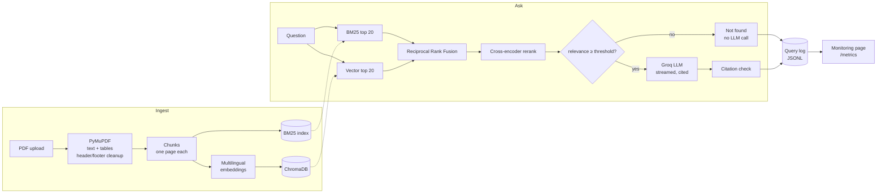

# ReguShield: Grounded Q&A for Regulatory Documents

ReguShield answers questions about regulatory and compliance PDFs (OJK regulations, internal
SOPs, codes of conduct). Every answer cites the source document and page. When the documents
do not contain the answer, it says so instead of guessing.

**Live demo:** https://regushield-ai-bnf3fmcobcvkp5ne3lg5en.streamlit.app/

[ISI: screenshot of the Assistant page after uploading a real document]

## The problem

Compliance, legal and HR staff answer questions like "may an employee accept a holiday gift
from a client?" by searching long regulations by hand. A general-purpose chatbot answers
faster, but it can invent an article number or a sanction that does not exist, and a wrong
compliance answer is worse than a slow one. ReguShield keeps the speed of a chatbot and adds
three safeguards:

1. It answers only from retrieved passages of *your* documents.
2. It shows those passages with file name and page, so every claim can be checked.
3. It refuses ("Informasi tersebut tidak ditemukan…") when nothing relevant was retrieved.

## Features

- **Hybrid retrieval.** BM25 catches exact terms and article numbers ("Pasal 12", "POJK 51").
  Multilingual vector search catches paraphrases ("hadiah" vs "gratifikasi"). The two
  rankings are merged with Reciprocal Rank Fusion.
- **Cross-encoder reranking.** A multilingual reranker (FlashRank, ONNX) rescores the merged
  candidates against the question. Its score is the relevance shown next to each source.
- **Relevance gate.** If no passage reaches the minimum relevance, the LLM is never called.
  That costs nothing and leaves no chance to hallucinate.
- **Cited, streamed answers.** Groq (`openai/gpt-oss-20b`) streams the answer with `[n]`
  markers. The app checks which sources were actually cited and flags uncited answers.
- **PDF handling.** Pages are numbered 1-based, so citations match the printed page. Tables
  are extracted as Markdown. Running headers, footers and page numbers are removed before
  indexing.
- **Document management.** Upload several PDFs, re-upload a new version (the old one is
  replaced), skip unchanged files, reject duplicates, delete documents.
- **Monitoring.** Every question is logged with latency per stage, time to first token,
  tokens, estimated cost, top relevance, whether sources were cited, errors and 👍/👎
  feedback. The Monitoring page and the `/metrics` endpoint show p50/p95 latency, cost per
  question, and not-found, uncited and error rates.
- **Same engine, three interfaces.** Streamlit UI, REST API (FastAPI) and CLI, packaged with
  Docker Compose.
- **Offline evaluation.** An LLM judge scores faithfulness, context relevance and
  correctness against hand-written answers.

## Architecture



## Design decisions and trade-offs

| Decision | Why | Trade-off |
|---|---|---|
| BM25 + vector search, merged with RRF | Legal text mixes exact identifiers with paraphrased concepts; each method misses what the other finds. RRF merges ranks without calibrating two score scales. | Two indexes to keep in sync. BM25 is rebuilt in memory from the vector store on start-up. |
| Cross-encoder reranker on the top 10 fused candidates | Reads question and passage together, which is more accurate than comparing embeddings, and gives a 0–1 score usable as a gate. | The slowest stage on CPU. Rescoring 20 candidates at 512 tokens was the bottleneck in local tests, so the default is 10 candidates at 256 tokens; the Monitoring page shows the effect. |
| Relevance gate before the LLM | The cheapest way to stop hallucination is not to ask the LLM when there is nothing to ground it. | The threshold (`REGUSHIELD_MIN_RELEVANCE`) has to be tuned with the evaluation set: too high refuses answerable questions. |
| ONNX models (FastEmbed, FlashRank), no PyTorch | Much smaller install and faster cold start on free hosting; CPU only. | Limited to the models these libraries ship. |
| `paraphrase-multilingual-MiniLM-L12-v2` embeddings | Small (~0.2 GB) and multilingual; the old English-only MiniLM matched Indonesian text poorly. | Reads only ~128 tokens per chunk. Chunks are kept to ~800 characters, and BM25 and the reranker still see the full text. |
| Chunks never cross a page | Every chunk cites exactly one page. | A sentence spanning two pages is split. |
| Groq `gpt-oss-20b`, temperature 0, low reasoning effort | Fast, cheap, deterministic enough for audit use. | Hosted API, so documents' passages leave the machine. |
| JSON Lines query log | Zero infrastructure; easy to inspect, export or ship to a real monitoring stack. | Not a time-series database; fine for a single instance. |

## Evaluation

`python -m eval.evaluate` runs every question in `eval/dataset.json` through the real
pipeline. A judge model (`openai/gpt-oss-120b` by default) then scores three things:

- **Faithfulness:** is every claim supported by the retrieved passages?
- **Context relevance:** do the passages contain what the question needs?
- **Correctness:** does the answer agree with the hand-written ground truth?

If the dataset lists `expected_pages`, the page hit rate is reported too. Judge outputs
that are not valid JSON are reported as missing, never as 0. Results are written to
`eval/results/` as a JSON report and as `latest.md`.

| Metric | Result |
|---|---|
| Faithfulness | [ISI: setelah menjalankan evaluasi] |
| Context relevance | [ISI] |
| Correctness | [ISI] |
| Latency p50 / p95 | [ISI] |
| Cases | [ISI: jumlah pertanyaan di dataset] |

The questions and ground-truth answers are hand-written from a code-of-conduct document
([ISI: nama dan sumber dokumen]). It is small; extending it is the most useful next step for
tuning the threshold and chunk size.

## Cost: free to run

- **Embedding and reranker models** are open-source and run on your own CPU (FastEmbed,
  FlashRank). They are downloaded once from Hugging Face; no account or API key is needed.
- **The LLM** runs on Groq. On the Free tier (an account without a payment method) nothing is
  billed. When a rate limit is reached, Groq refuses the request and the app shows a "batas
  request" message. Charges only start after upgrading to a paid tier and adding a payment
  method, where spend limits can be set.
- The cost figures on the Monitoring page are *estimates* of what the same usage would cost
  on a paid tier, for capacity planning. They are not charges.

## Run it

### Local

```bash
python -m venv .venv
source .venv/bin/activate        # Windows PowerShell: .venv\Scripts\Activate.ps1
pip install -r requirements-dev.txt
cp .env.example .env              # then put your GROQ_API_KEY in .env
streamlit run app.py
```

The embedding and reranker models (a few hundred MB) are downloaded on first use into
`data/models/`, so the first upload or question takes longer.

### Docker Compose (UI + API)

```bash
docker compose up --build
# UI  http://localhost:8501
# API http://localhost:8000/docs
```

Both services share one volume, so a document uploaded in the UI can be queried through the
API. ChromaDB runs embedded in each process; for many concurrent writers, run ChromaDB as a
server instead.

### Streamlit Community Cloud

Set `GROQ_API_KEY` under *Settings → Secrets* (see `.streamlit/secrets.toml.example`). Storage
there is temporary, so uploaded documents and logs are lost when the app restarts.

### REST API

```bash
curl -F "file=@kode_etik.pdf" http://localhost:8000/documents
curl -X POST http://localhost:8000/query -H "Content-Type: application/json" \
     -d '{"question": "Apa saja jenis sanksi pelanggaran kode etik?"}'
curl http://localhost:8000/metrics
```

| Endpoint | Purpose |
|---|---|
| `GET /health` | Status, number of documents and chunks, whether the LLM is configured |
| `GET /documents` · `POST /documents` · `DELETE /documents/{name}` | Manage indexed PDFs |
| `POST /query` | Answer with sources, latency breakdown, tokens and cost |
| `GET /metrics` | Monitoring summary |

Set `REGUSHIELD_API_KEY` to require an `X-API-Key` header on everything except `/health`.

### CLI

```bash
python -m regushield ingest docs/*.pdf
python -m regushield ask "Kepada siapa benturan kepentingan dilaporkan?"
python -m regushield metrics
```

## Configuration

All settings are environment variables (or `.env`). Only `GROQ_API_KEY` is required.

| Variable | Default | Meaning |
|---|---|---|
| `GROQ_API_KEY` | – | Groq key; without it the app still retrieves passages but does not answer |
| `REGUSHIELD_LLM_MODEL` | `openai/gpt-oss-20b` | Answer model |
| `REGUSHIELD_EMBEDDING_MODEL` | `sentence-transformers/paraphrase-multilingual-MiniLM-L12-v2` | Changing it builds a new index |
| `REGUSHIELD_RERANKER_MODEL` | `ms-marco-MultiBERT-L-12` | `REGUSHIELD_RERANK=false` disables reranking |
| `REGUSHIELD_RERANK_CANDIDATES` / `REGUSHIELD_RERANK_MAX_TOKENS` | `10` / `256` | Passages the reranker rescores, and tokens per pair: the main latency knobs on CPU |
| `REGUSHIELD_MIN_RELEVANCE` | `0.10` | Relevance gate |
| `REGUSHIELD_TOP_K` / `REGUSHIELD_CANDIDATES` | `4` / `20` | Passages sent to the LLM / taken from each retriever |
| `REGUSHIELD_CHUNK_SIZE` / `REGUSHIELD_CHUNK_OVERLAP` | `800` / `120` | Characters |
| `REGUSHIELD_PRICE_INPUT_PER_M` / `..._OUTPUT_PER_M` | list price | USD per 1M tokens, used for the cost estimate |
| `REGUSHIELD_LOG_QUESTIONS` | `true` | `false` keeps question text out of the log |
| `REGUSHIELD_API_KEY` | – | Protects the REST API |
| `REGUSHIELD_DATA_DIR` | `data` | Uploaded PDFs, index, logs, models |

## Project structure

```
.
├── app.py                 # Streamlit entry point (navigation)
├── views/                 # Streamlit pages: assistant, documents, monitoring
├── regushield/            # Engine, independent of the UI
│   ├── config.py          # Settings from environment
│   ├── pdf.py             # PDF -> pages (text, tables, cleanup)
│   ├── chunking.py        # Page-bounded chunks
│   ├── models.py          # Embedding and reranker models (ONNX)
│   ├── store.py           # ChromaDB store
│   ├── retrieval.py       # BM25, RRF, hybrid retriever, rerank
│   ├── prompts.py         # Grounded prompt, citation parsing
│   ├── llm.py             # Groq streaming client
│   ├── engine.py          # Ingest / ask pipeline, relevance gate, logging
│   ├── monitoring.py      # Query log and summary metrics
│   ├── api.py             # FastAPI service
│   └── __main__.py        # CLI
├── eval/                  # Dataset and LLM-judge evaluation
├── tests/                 # pytest suite (no network: fake models and LLM)
├── Dockerfile, docker-compose.yml
└── requirements.txt, requirements-dev.txt, pyproject.toml
```

## Tests

```bash
pytest
ruff check .
```

The suite runs offline in about 20 seconds. Deterministic fakes replace the embedding model,
reranker and LLM. It covers PDF parsing (generated PDFs with tables and headers), chunking,
BM25/RRF/rerank, the relevance gate, citation checks, error handling, monitoring, the REST
API, the CLI and the Streamlit pages end to end.

## Limitations

- Scanned PDFs (images without a text layer) are rejected; there is no OCR.
- Retrieval quality depends on the threshold and chunk size, which should be tuned with a
  larger evaluation set than the one included.
- The cost figure is an estimate from token counts and list prices, which change; check
  Groq's pricing.
- Passages are sent to Groq's hosted API. Do not upload confidential documents to the public
  demo.
- Single-instance design: embedded ChromaDB and a local log file. Scaling out needs a
  ChromaDB server and a shared log or metrics store.

## Tech stack

Python · Streamlit · FastAPI · ChromaDB · rank-bm25 · FastEmbed · FlashRank · PyMuPDF · Groq ·
Docker · pytest · ruff